# steel

A small neural network that watches crypto markets around the clock, forecasts each name's
return distribution over the next hour, keeps training on its own predictions as they
resolve, and reads the crowd (funding, open interest, Fear & Greed, Reddit) to lean against
it. It runs continuously and shows everything in a browser page: an at-a-glance brief,
per-name forecast cards, a whole-market overview with a 250-name radar, and a control panel
for the universe, data sources, keys, and signals.

Steel is the crypto sibling of [flint](../flint), which does the same for US equities. The
model, the online learner, the backtester and the dashboard are shared designs; what differs
is everything a market that never closes changes: the clock, the venues, the signals, and
how a bearish view is held.

It is a research toy. The forecasts are in basis points, the paper book pays every cost a
real fill would (venue fees, the spread, funding, and the fee and wait of moving money
between venues), and none of it is advice. Do not trade on it.

The public page is [steel.thingg.co](https://steel.thingg.co) (served from `docs/`; the running box also serves it at `/docs/`), with the [whitepaper](docs/whitepaper.html) and the [redesign proposal](docs/design/redesign-proposal.html) beside it.

## Screenshots

Each picture follows your theme: GitHub shows the dark one on a dark setting and the light one otherwise.

The Desk: the status strip with the trader's routine, the screener as a table or a heatmap, the
model's calls and cards, the next events and the dislocations.

<picture><source media="(prefers-color-scheme: dark)" srcset="docs/img/desk-dark.png">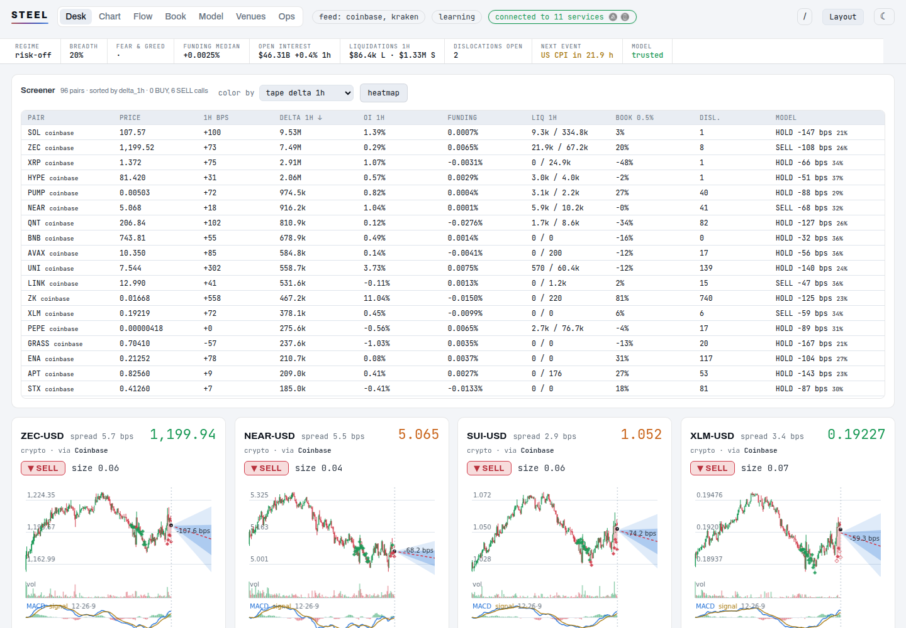</picture>

The Chart with the pair rail: candles from every venue's prints, the forecast fan with the longer
horizons' medians, the layers, and the pair's tape, book, derivatives and options beside it.

<picture><source media="(prefers-color-scheme: dark)" srcset="docs/img/chart-dark.png">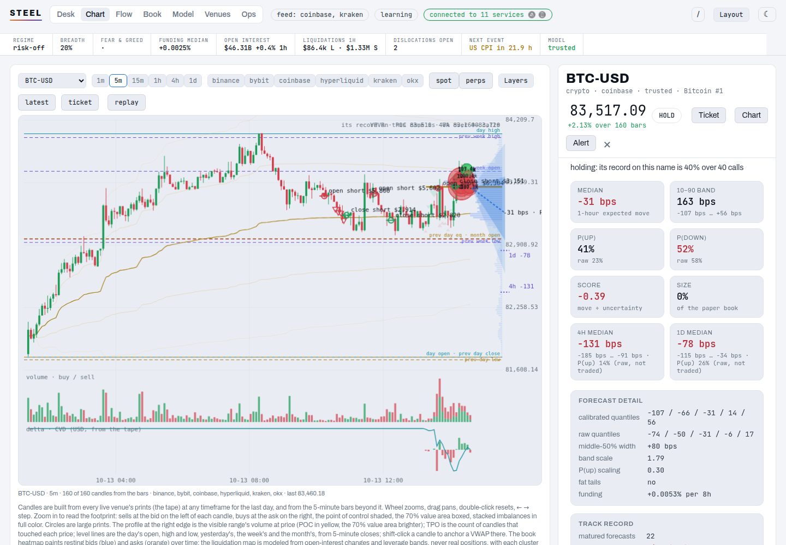</picture>

| Flow | Model |
|---|---|
| <picture><source media="(prefers-color-scheme: dark)" srcset="docs/img/flow-dark.png">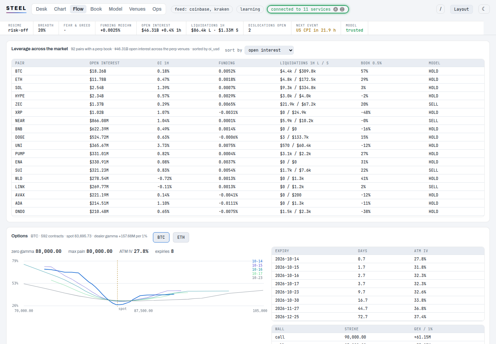</picture> | <picture><source media="(prefers-color-scheme: dark)" srcset="docs/img/model-dark.png">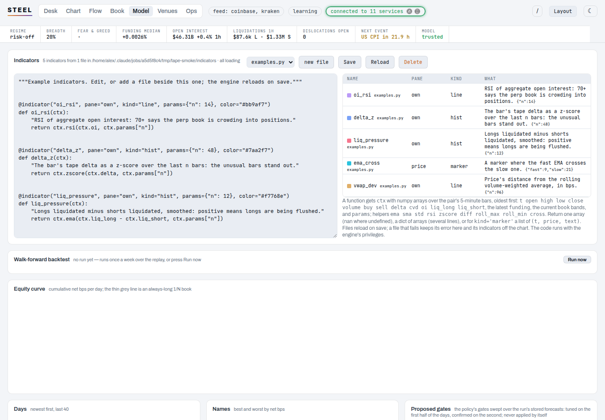</picture> |

| Book | Venues | Ops |
|---|---|---|
| <picture><source media="(prefers-color-scheme: dark)" srcset="docs/img/book-dark.png">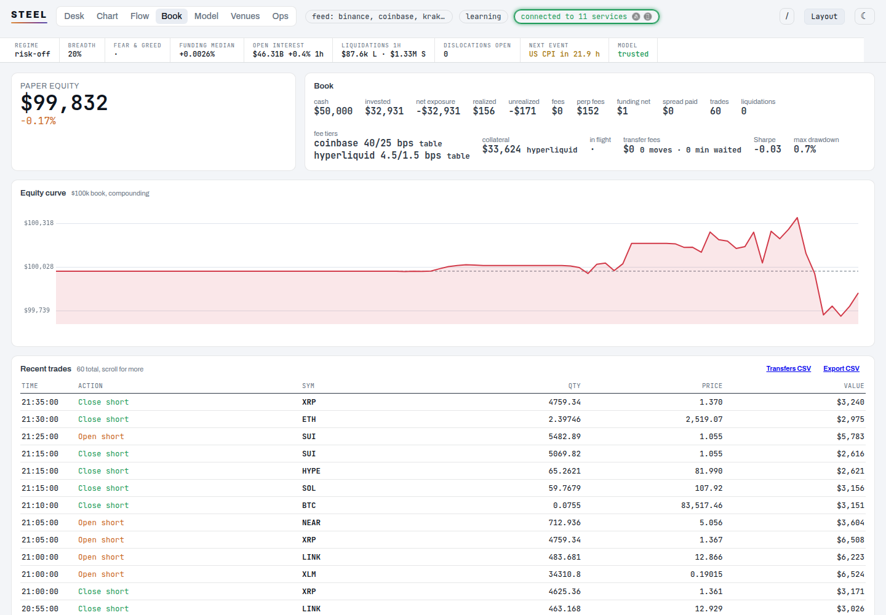</picture> | <picture><source media="(prefers-color-scheme: dark)" srcset="docs/img/venues-dark.png">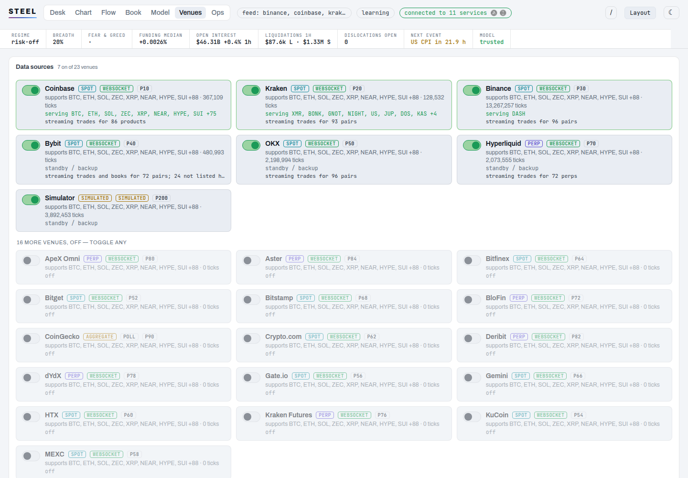</picture> | <picture><source media="(prefers-color-scheme: dark)" srcset="docs/img/ops-dark.png">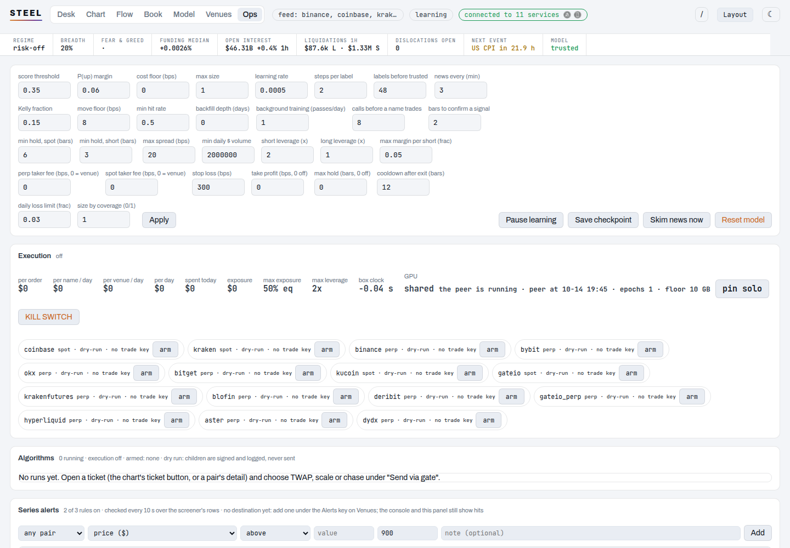</picture> |

The screener as a heatmap, the calendar and prediction markets, and the series alerts on Ops.

| Screener | Events and prediction markets | Series alerts |
|---|---|---|
| 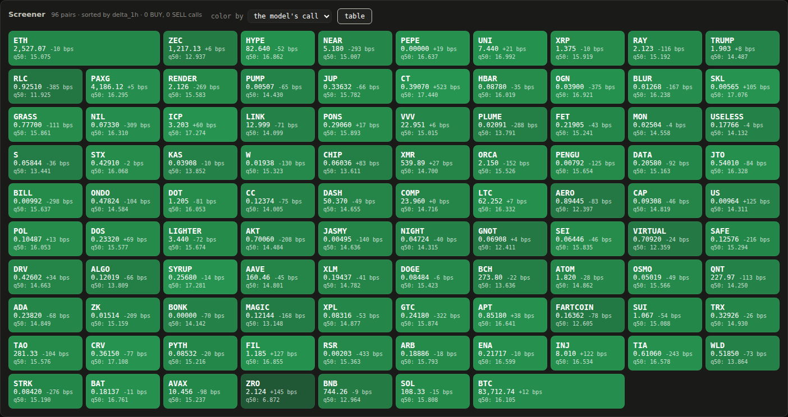 | 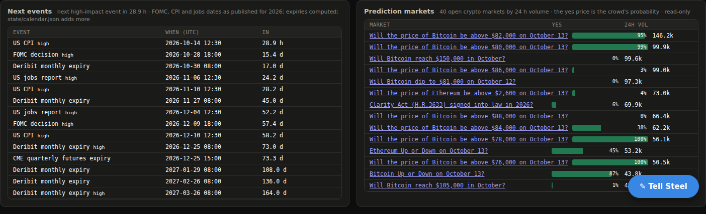 | 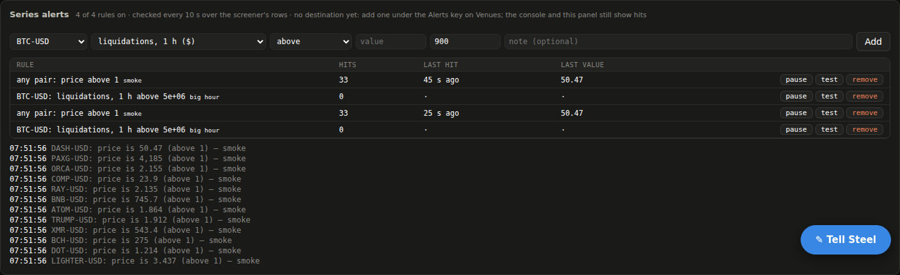 |

On a phone: <picture><source media="(prefers-color-scheme: dark)" srcset="docs/img/phone-dark.png">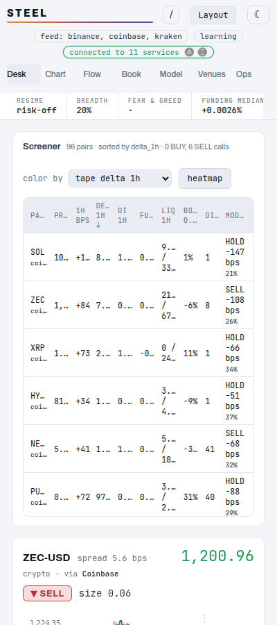</picture>

## Setup

Steel needs Python 3.11 or newer and [uv](https://docs.astral.sh/uv/). Everything else is
installed by uv into a `.venv` in the checkout.

```
curl -LsSf https://astral.sh/uv/install.sh | sh    # once, if uv is not installed
git clone <this repo> steel && cd steel
uv sync                                           # the venv, torch and every dependency
uv run playwright install chromium                # only for the headless-browser news skimmer
```

A GPU is optional. On CUDA or Apple Silicon the first start benchmarks a ladder of model
sizes and caches the choice; on a CPU-only box it picks a small net. Nothing needs a key:
market data, signals, the radar and the news are all public endpoints.

## Run

```
uv run steel
```

Open http://127.0.0.1:8100. On start it pages 30 days of 5-minute candles for the universe
from the spot venues, warms the net up on them (a few minutes, with a held-out guard), and
switches to the live websocket feeds; the page shows the progress. The default universe is a
60-name core of liquid Coinbase names plus every dollar pair the enabled venues list above
$1M a day.

```
uv run steel --symbols BTC,ETH,SOL,HYPE          # bare bases or BTC-USD, either works
uv run steel --feed kraken --port 9000 --no-news
uv run steel --host 0.0.0.0                      # reachable from the LAN
```

A CPU smoke run with a few names, no news and no deep history, in a scratch state directory,
is the quickest way to see the whole pipeline work:

```
STEEL_DEVICE=cpu STEEL_AUTO_SIZE=0 STEEL_SYMBOLS=BTC,ETH,SOL STEEL_STATE_DIR=/tmp/steel-smoke \
  STEEL_NEWS=0 STEEL_DEEP_BACKFILL_DAYS=0 uv run steel
```

To restart, stop the old process first (a second instance refuses to start while :8100 is
busy): `pkill -9 -f "python -m steel"`, wait for the port to free, then run it again. A
restart re-runs the backfill and the warmup, so avoid it unless a change needs it; frontend
edits are static files and only need a reload.

### First run

- **The operator token.** Every change made from the dashboard (controls, keys, arming,
  the kill switch, promotion) needs a token Steel generates on first start and seals in its
  vault. `uv run steel token` prints it; the page asks for it once and remembers it in the
  browser. `STEEL_AUTH=all` closes the reads and the websocket too; `STEEL_AUTH=off` opens
  everything (a trusted LAN only).
- **The vault.** Keys are sealed at rest by a master key Steel generates (`state/vault.key`).
  The dashboard shows the recovery copy once; save it, acknowledge it, and it is never shown
  again. `uv run steel vault status|rotate|restore <key>`.
- **Keys.** Optional, pasted in on the Venues tab: read-only exchange keys for the Portfolio
  tab, a free CoinGecko demo key for the radar's rate limit, alert destinations, and separate
  trade keys for execution. Make the exchange keys read-only ("View" on Coinbase, "Query
  Funds" on Kraken, "Read" everywhere else).

### Commands

All of them run as `uv run steel <command>`; none needs the server running except `handoff`.

| command | what it does |
|---|---|
| `steel` | start the server (`--symbols`, `--feed`, `--host`, `--port`, `--no-news`, `--log-level`) |
| `steel check` | what a start would do here: device, free memory, the cached model size; exits non-zero when the model would not fit |
| `steel venues` | every market-data source, balance reader and order client with its id and default state |
| `steel appendix [--check]` | regenerate the whitepaper's appendix (settings, features, routes) from the code; `--check` exits 1 when it is stale |
| `steel mcp [--rules]` | an MCP server on stdin/stdout over Steel's API for an agent (Claude Code, Claude Desktop): every store as a tool, reads only; `--rules` adds the series-alert tools. Never orders |
| `steel token [rotate]` | print (or replace) the operator token the dashboard needs for any change |
| `steel vault status\|rotate\|restore <key>` | the key vault: what is sealed, a new master key, a restore on a new box |
| `steel backup [dir] [--replay]` | one archive of the checkpoint, vault key, token, sealed keys, ledgers and universe (`--replay` adds the replay buffer); `STEEL_BACKUP_DIR` makes the server write one a day |
| `steel restore <archive>` | unpack a backup into the state directory |
| `steel replay` | a report on the saved training state |
| `steel backtest [--days N] [--cost BPS] ...` | a walk-forward backtest over the saved replay (the server runs its own weekly; do not run this beside it) |
| `steel sweep` | the policy's gates swept over the last backtest's stored forecasts |
| `steel arb-replay [--days N] [--latency-ms L]` | what the arbitrage rules would have captured in the dislocation log, by latency, after fees and inventory transfers |
| `steel probe [--only VENUE] [--json]` | every venue against the contract its code expects (also nightly in GitHub Actions) |
| `steel handoff [auto\|shared\|solo]` | the running Steel's GPU mode next to Flint |
| `steel version` | the package version |

### Tests

```
STEEL_DEVICE=cpu uv run pytest -q tests
```

The suite runs without a model or a feed: the risk rules, the policy gates, the paper book
(a fuzz, a liquidation, funding, transfers between venues), every venue's message parsing,
the account signing, the vault, the token, alerts, the panic path, backups and the routes.

### Configuration

Every field in `steel/config.py` can be set with a `STEEL_<NAME>` environment variable, e.g.
`STEEL_BAR_SECONDS=60 STEEL_MAX_UNIVERSE=48 STEEL_TRADE_VENUE_PERP=bybit`. Most policy knobs
are also live controls on the Ops tab. `STEEL_FEES` names a json file that overrides any
venue's fee profile or an asset's transfer rails. The state directory (`STEEL_STATE_DIR`,
`state/` by default) holds the checkpoint, the replay, the vault key, the ledgers and the
machine cache; the key files sit beside it in the working directory, gitignored.

### Deploying on a box that never sleeps

`deploy/spark/install.sh` installs Steel as an always-on systemd user service (the Spark's
`STEEL_*` environment lives in `deploy/spark/steel-start`). Then:

```
systemctl --user start steel        # or stop; a stop saves the checkpoint on the way out
journalctl --user -u steel -f       # follow the log
uv run steel handoff                # which GPU mode it is in next to Flint
```

Steel and Flint share one GPU: Steel watches for Flint, keeps a memory floor and its base
training budget while Flint runs, and trains three times harder with a low floor when Flint
is off. Flint's start script can call `deploy/spark/steel-handoff shared` to have Steel step
back first.

## Compute — GPU and auto-sizing

On start steel detects the best device (CUDA, then Apple's Metal/MPS, then CPU) and, on a
new machine, benchmarks a ladder of model sizes to pick the largest that still trains
within the bar interval. The result is cached to `state/machine.json`, so shared to a
different machine it adapts on its own — a big model on a GPU box, a small one on a
laptop. It refuses to start when the box cannot hold the model next to its replay buffer,
and names whatever else is holding the memory.

## The model

Ticks are aggregated into 5-minute bars, aligned across names. Each bar becomes a set of
features per name: price microstructure (return, range, volume, order-flow imbalance,
spread, trade count, close position, momentum, realized volatility) plus slow-moving
exogenous signals (news tone and attention, Reddit tone and attention, Fear & Greed, perp
funding, open-interest change, the long/short ratio, the basis, Deribit's DVOL, BTC
dominance, market breadth, and stablecoin supply flow).

SteelNet takes the last N bars of every name and predicts the 10/25/50/75/90 quantiles of
each name's return over the next hour plus a probability the return is positive. It
combines a per-name dilated causal convolution stack read out at several scales,
cross-asset attention, and a regime gate mixing several expert heads, with a second and
third set of quantiles for the 4-hour and 24-hour horizons from the same trunk. Quantiles
are non-crossing by construction. Learning is online: every bar it forecasts, the horizon
later the realized return becomes a label, and a few optimizer steps run per label from a
replay buffer. Because the market never closes, a background trainer keeps working through
the replay between bars (up to a budget per UTC day, with a held-out overfit guard), and
a deep backfill pages Coinbase history back months while the model is already live.
Checkpoints save to `state/`.

## Data sources

Market data is a registry of venues you toggle from the control panel; each name is served
by the highest-priority live source, with automatic failover. On by default: **Coinbase**
(websocket trades, 5-minute candles years deep), **Kraken** (websocket, recent candles) and
**Hyperliquid** (the perp DEX). Available but off, a toggle away: the spot venues **Binance**,
**Bybit**, **OKX**, **Bitget**, **KuCoin**, **Gate.io**, **MEXC**, **HTX**, **Crypto.com**,
**Bitfinex**, **Gemini** and **Bitstamp**; the perp venues **BloFin**, **Kraken Futures**,
**dYdX**, **ApeX**, **Deribit** and **Aster**; and **CoinGecko** (aggregate prices, no candles).
None needs a key. `uv run steel venues` lists them with their ids.

The universe is every dollar pair those venues list above a liquidity floor ($1M a day,
about 120 Coinbase names today), plus the configured core and whatever you hold, refreshed
daily; a thin name leaves only after a grace period. There is no artificial cap below the
hard one (512).

Keys are sealed at rest by Steel's own vault (a master key it generates; the recovery copy is
shown once). Execution exists but is off by default: fifteen order clients (Coinbase, Kraken,
Binance, Bybit, OKX, Bitget, KuCoin, Gate.io spot and perps, Kraken Futures, BloFin, Deribit,
Hyperliquid, Aster, dYdX) behind a master switch, per-venue arming with a separate trade
key, hard caps, a clock check, a kill switch and an audit log, in dry-run until you say
otherwise.

The Portfolio tab reads balances and open positions from any of those venues (and from BitMEX,
which closed its exchange in September 2026 but still holds balances) with a **read-only** API
key, or just a wallet address on Hyperliquid and dYdX. Steel never places an order anywhere:
every reader goes through one gate that only allows the balance endpoints it declares, and a
test pins it.

With 21 venues quoting the same names, the dashboard also shows every **cross-venue
dislocation**: a bid on one venue above an ask on another after both taker fees, with how
long it lasted. Steel measures those windows; it does not trade them.

Signals: **Bybit** and **Hyperliquid** perp funding, open interest, basis and the retail
long/short ratio for every name; **Deribit** DVOL (the crypto VIX); **alternative.me** Fear & Greed;
**ApeWisdom** Reddit crypto chatter; **CoinGecko** for the top-250 radar, breadth, category
rotation and dominance; **DefiLlama** for stablecoin supply. None needs a key either; a
free CoinGecko demo key raises its rate limit.

Optional read-only account keys (Coinbase, Kraken) show your balances on the Portfolio tab
and add your holdings to the universe. They go in gitignored files or the **API keys
panel**, are masked everywhere in the UI, API, and logs, and are only ever used to read
balances. Steel never places an order.

## Paper trading and risk

The paper book runs $100k, compounding, persisted across restarts. A bullish view is a 1x
perpetual long on the perp venue (or spot, in `long_mode=spot`); a bearish view is an
isolated-margin perpetual short at 2x: the margin posted is the most it can lose, because
the venue liquidates it there, and the book settles exactly that. Funding accrues on every
perp at the venue's rate; the policy charges a position's funding and the venue's real
taker fees against its edge before it trades. The book keeps its cash on the spot venue and
its collateral on the perp venue, and moving money between them is an on-chain stablecoin
transfer that costs its fee and takes its minutes: a position waits for the money to land.
There is no naked borrow and no leverage on the book.

Gates before any trade: per-name directional skill, confirmation over several bars, the
4-hour view agreeing with the 1-hour call, the live spread, the daily dollar volume, the
price impact of the order, a stop, a cooldown after an exit and a daily loss limit. Positions
are sized to a daily volatility target, no sector carries more than 40% gross, and the book's
net BTC beta is capped. A crowd overlay trims or flips calls that lean with euphoria (hot
funding, lopsided positioning, greed, Reddit attention).

Going live is a separate, deliberate step: execution is off by default, every venue has to be
armed with its own trade key, every cap has to be set, and the paper book's record has to
pass a checklist before the operator promotes it from the Ops tab. Once live, every paper
fill mirrors to the venue at a fraction of its size, the book reconciles what it holds
against the exchange, and it demotes itself on a drawdown, a drift or the kill switch.
Alerts (Telegram, Discord, a webhook) carry fills, calls, refusals, stalls and demotions.

## Universe

The control panel lets you curate what the model trades: add any name a venue lists,
remove one, mute to pause it (muting frees its compute and API calls), or pull in the
current top movers from the radar. Once a day the universe refreshes itself: the configured
core, every holding, and the most interesting names from the radar and the news, with a
grace period before a name is demoted. Changing the universe migrates the model and the
replay instead of resetting them.

## The interface

Seven views, by what the operator is looking at (every panel is a widget: drag its grip to
reorder, collapse it, export the layout from the header's Layout menu; `/` or ctrl+K opens the
command palette, `1`–`7` switch views):

- **Market** — the whole market: the screener (every pair by every stored series, as a table or
  a heatmap), the next scheduled events, Polymarket's crypto markets, Deribit's options surface,
  regime, breadth / Fear & Greed / DVOL, category rotation, dominance and stablecoin flow, the
  cross-venue dislocations, the watch list, the 250-name radar, the news and the brief.
- **Chart** — candles from every venue's prints at any timeframe, the footprint, volume
  profile and TPO, the book and liquidation heatmaps, net positioning, GEX, the indicator
  catalog and your own Python indicators, the model's calls and forecast fan, paper fills and
  transfer waits, the order ticket's draggable rays, and bar replay.
- **Names** — a forecast card per name (the chart plus the forecast fan), ranked by urgency;
  a detail view with the longer horizons, the crowd, the identity of the coin, and a copyable
  order ticket for placing the call by hand; the universe editor.
- **Book** — the paper book: positions with their liquidation prices, funding, collateral and
  money in flight, the equity curve, every fill (CSV export), and the real exchange balances
  with their equity over time.
- **Venues** — the data sources and their toggles, the signal providers, every key and the
  vault.
- **Research** — the indicator editor, the weekly walk-forward backtest and the policy sweep,
  the model's live scorecard, calibration by name, feature drift with the net's weight per
  feature, and the arbitrage replay.
- **Ops** — the live controls, execution (arming, caps, the clock, the GPU mode, the kill
  switch), the algorithm runs, the series alerts, the live book and its promotion checklist,
  the arbitrage switch, the consoles.

Everything is on the websocket, also reachable over HTTP: `GET /api/state`, `/api/news`,
`/api/sources`, `/api/signals`, `/api/keys`, `/api/backtest`, `/api/monitor`,
`/api/dislocations`, `/api/arb/replay`, `/api/ticket/{sym}`, `/api/export/{what}.csv`, and
`POST /api/control`, `/api/keys`, `/api/execution`, `/api/live`, `/api/arb`, `/api/handoff`
(the POSTs need `Authorization: Bearer <token>`).

## Your own indicators

Drop a Python file in `state/indicators/` (or write it in the Research tab's editor):

```python
@indicator("oi_rsi", pane="own", kind="line", params={"n": 14}, color="#bb9af7")
def oi_rsi(ctx):
    "RSI of open interest: crowding into one side of the perp book."
    return ctx.rsi(ctx.oi, ctx.params["n"])
```

`ctx` carries numpy arrays over the pair's bars (OHLCV, buy and sell volume, the tape's delta and
CVD, open interest, liquidations by side), the latest funding, the book bands and a few helpers
(`ema`, `sma`, `std`, `rsi`, `zscore`, `diff`, `cross`). Files reload on save; each indicator shows
up in the chart's Layers menu under "yours" as its own pane, a price overlay or markers. Steel
writes `examples.py` on first start.

## The data API

Everything Steel stores is readable by other programs under `/api/v1`: markets, the screener,
candles at any timeframe, the tape and delta by size band, footprints, books and heatmaps, the
liquidation map, derivatives, positioning, premiums, levels, options, the model's forecast, the
calendar and the prediction markets, plus one websocket stream of trades, book tops,
liquidations, bars and rule hits. Reads only, behind the operator token, under a weight budget
per minute. `docs/api.md` documents every route and shape; `GET /api/v1` returns the index.

## Layout

```
steel/config.py    settings and STEEL_* overrides; canonical pair names
steel/clock.py     UTC days and the weekly backtest window (there is no session)
steel/autotune.py  device detection + first-run model auto-sizing + the memory guard
steel/feed.py      shared Tick type and the offline simulator
steel/sources/     one module per market-data venue (21 venues + CoinGecko) + the manager
steel/bars.py      tick to bar aggregation, aligned across names
steel/features.py  feature engineering and running normalization
steel/model.py     SteelNet and the loss
steel/learner.py   replay buffer, optimizer loop (GPU/MPS/CPU), checkpoints
steel/signals.py   Reddit chatter, Fear & Greed, Bybit + Hyperliquid perp positioning, Deribit DVOL
steel/market.py    whole-market scan: CoinGecko radar, breadth, categories, stablecoin flow
steel/news.py      news hub: headless-browser skimmer over the crypto desks
steel/paper.py     the paper book: spot longs, margined perp shorts, funding
steel/policy.py    cost and exit arithmetic: impact, Amihud, funding carry, liquidation
steel/accounts/    read-only balance readers (and fee tiers), one per venue, behind one endpoint gate
steel/execution/   order clients, one per venue, behind the execution gate (off, dry-run)
steel/live.py      the live book: promotion checklist, mirroring, reconciliation, flatten
steel/arb.py       the arbitrage executor; steel/arbreplay.py its replay over the dislocation log
steel/dislocation.py  cross-venue dislocations; steel/identity.py which coin a ticker is
steel/vault.py     the key vault; steel/auth.py the operator token; steel/alerts.py alerts
steel/handoff.py   the GPU handoff with Flint; steel/clockcheck.py the box clock vs the venues
steel/backup.py    backup and restore; steel/probe.py the venue contract check
steel/engine.py    orchestration, policy + crowd overlay, universe, metrics, controls
steel/backtest.py  walk-forward backtest; steel/sweep.py the policy sweep
steel/server.py    FastAPI app, websocket, control + keys endpoints
web/               dashboard (no build step, plain HTML/CSS/JS)
deploy/spark/      an always-on systemd user service for the Spark
tests/             pytest suite: risk rules, gates, checkpoints, bars, features, sources, signals, routes
```

See `CLAUDE.md` for the invariants the code keeps, `TODO.md` for the roadmap, and
[`docs/whitepaper.html`](docs/whitepaper.html) for the design and the reasons behind it (a
companion to Flint's whitepaper; open it in a browser).

## License

PolyForm Noncommercial 1.0.0: free for personal, hobby, research and other noncommercial use.
Commercial use needs a separate license. See LICENSE and NOTICE.

© 2026 thingg LLC · [thingg.co](https://thingg.co)
